<div align="center">

<!-- HEADER ANIMADO -->
<a href="https://github.com/HenriqueHintz">
  
</a>

<!-- TYPING SVG -->
<a href="https://git.io/typing-svg">
  
</a>

<br/>

<!-- BADGES DE STATUS & CONTATO RÁPIDO -->
<p align="center">
  <a href="https://wa.me/5548991808700" target="_blank">
    
  </a>
  <a href="mailto:rico.pompeo@gmail.com" target="_blank">
    
  </a>
  <a href="https://www.linkedin.com/in/henriquehintz/" target="_blank">
    
  </a>
  <a href="https://henriquehintz.netlify.app/" target="_blank">
    
  </a>
</p>

<!-- DOCUMENTAÇÃO & CARTAS DE RECOMENDAÇÃO -->
<p align="center">
  <a href="./docs/Curriculo_Henrique_Hintz.pdf" target="_blank">
    
  </a>
  &nbsp;
  <a href="./docs/Carta_Recomendacao_EDM_Software.pdf" target="_blank">
    
  </a>
  &nbsp;
  <a href="./docs/Carta_Recomendacao_Vai_de_Bolsa.pdf" target="_blank">
    
  </a>
</p>


</div>

---

## 👨‍💼 Perfil Profissional

```typescript
const henriqueHintz = {
  nome: "Henrique Hintz Pompeo Pereira",
  formação: "Bacharelado em Sistemas de Informação (UNISUL - 02/2025)",
  localização: "Florianópolis, SC — Brasil",
  especialidades: [
    "Implantação e Parametrização de Sistemas B2B",
    "Quality Assurance (QA) & Testes Manuais/Funcionais",
    "Automação de Rotinas e Integração de APIs com Python",
    "Customer Onboarding, Treinamento e Suporte N2/N3",
    "Desenvolvimento de Aplicações Web (TypeScript, React, Next.js)"
  ],
  stackPrincipal: ["Python", "JavaScript/TypeScript", "PostHog", "ClickUp", "Jira", "Excel Avançado", "APIs REST"],
  valores: ["Comprometimento", "Organização", "Agilidade de Aprendizado", "Resolução Pragmática de Problemas"]
};
```

Profissional formado em **Sistemas de Informação (UNISUL)** com sólida experiência atuando na **ponte estratégica entre clientes de negócio e equipes técnicas de engenharia**. 

Possuo experiência prática comprovada em:
- **Implantação de Software & Onboarding**: Preparação de ambiente, configuração de parâmetros, mapeamento de processos, homologação e suporte pós-implantação.
- **Garantia da Qualidade (QA)**: Planejamento e execução de testes manuais e funcionais, controle de regressão, triagem e acompanhamento de ciclo de vida de bugs com **PostHog**, **ClickUp** e **Jira**.
- **Automação & Integração**: Desenvolvimento de automações em **Python** para integração de planilhas de grande porte com APIs REST, reduzindo retrabalho e inconsistências de dados.
- **Customer Success & Suporte Avançado**: Treinamento de equipes de clientes, criação de manuais técnicos de processos e gestão de carteira por status e criticidade.
- **Desenvolvimento Fullstack**: Criação de produtos digitais com foco em performance, experiência mobile-first e conversão.

---

## 🌟 Cartas de Recomendação & Reconhecimento

> As cartas de recomendação completas assinadas estão disponíveis para consulta no repositório em [`/docs`](./docs/).

<table>
<tr>
<td width="50%" valign="top">

### 🏢 EDM SOFTWARES LTDA
**Wesley de Carvalho — Gerente de Suporte Técnico**
> *"Henrique desempenhou suas atividades com **responsabilidade, comprometimento e dedicação**, atuando principalmente no acompanhamento e suporte aos clientes, além de contribuir para diferentes etapas dos processos de implantação e utilização do sistema.*
> 
> *Demonstrou como principais características a **organização de documentos, agilidade na execução dos processos, facilidade de aprendizado e excelente capacidade de trabalho em equipe**."*
> 
> 📄 [Ver documento assinado em PDF](./docs/Carta_Recomendacao_EDM_Software.pdf)

</td>
<td width="50%" valign="top">

### 🎓 VAI DE BOLSA
**Adonai Cruz — Diretor de Tecnologia (CTO)**
> *"Henrique atuou na área de tecnologia em nossa empresa... Henrique demonstrou ser um **profissional comprometido e responsável**, especialmente no cumprimento de sua carga horária presencial, comparecendo regularmente sem registros de faltas ou atrasos.*
> 
> *Recomendo o Henrique para futuras oportunidades profissionais, acreditando que **seu comprometimento será um diferencial**."*
> 
> 📄 [Ver documento assinado em PDF](./docs/Carta_Recomendacao_Vai_de_Bolsa.pdf)

</td>
</tr>
</table>

---

## 🎯 Pilares de Atuação Técnica

```mermaid
flowchart TD
    subgraph S1["🚀 Implantação & Sucesso"]
      A1["Parametrização & Ambiente"] --> A2["Treinamento de Usuários"]
      A2 --> A3["Manuais & Documentação"]
    end

    subgraph S2["🧪 Quality Assurance (QA)"]
      B1["Testes Manuais & Funcionais"] --> B2["Triagem PostHog / ClickUp"]
      B2 --> B3["Validação de Correções"]
    end

    subgraph S3["⚙️ Automação & Dados"]
      C1["Scripts Python"] --> C2["Extração & Tratamento Excel"]
      C2 --> C3["Integração de APIs REST"]
    end

    subgraph S4["💻 Engenharia Web"]
      D1["TypeScript & React/Next.js"] --> D2["Interfaces Mobile-First"]
      D2 --> D3["Deploy Contínuo Vercel"]
    end
```

<div align="center">



</div>

---

## 💼 Experiência Profissional

### 🏢 **EDM Softwares** — *Analista de Sistemas / Suporte Técnico & Implantação de Software de Automação*
**01/2026 – 08/2026 | Florianópolis/SC**
- Realização de testes de qualidade (**QA**) em novas funcionalidades desenvolvidas pela equipe antes do deploy em produção.
- Execução do processo de **implantação, homologação e parametrização de sistemas** em clientes corporativos.
- Condução de **treinamentos presenciais e remotos**, acompanhamento pós-go-live e suporte técnico continuado.
- Criação e atualização de **manuais de processos, bases de conhecimento e documentações** técnicas do sistema.
- Desenvolvimento de **planilhas automatizadas** para controle e classificação da carteira de clientes por status de implantação.
- *Carta de recomendação emitida pelo Gerente de Suporte Técnico (Wesley de Carvalho).*

### 💼 **Vai de Bolsa** — *QA & Automação em Python*
**07/2024 – 07/2025 | Florianópolis/SC**
- Execução rigorosa de **testes manuais e de rotina** em aplicações web de alto tráfego.
- Monitoramento de erros, comportamento de usuário e **registro estruturado de bugs** com **PostHog** e **ClickUp**.
- Desenvolvimento de **scripts de automação em Python** para extração, validação e envio automatizado de dados do Excel para APIs REST.
- Manutenção e refinamento de interfaces de usuário utilizando **JavaScript** e **TypeScript**.
- Gestão de repositórios e versionamento de código em equipe utilizando **Bitbucket** e **Git**.
- *Carta de recomendação emitida pelo Diretor de Tecnologia (Adonai Cruz).*

---

## 🎓 Formação Acadêmica & Certificações

### 🎓 **Bacharelado em Sistemas de Informação**
**Universidade do Sul de Santa Catarina — UNISUL** *(Conclusão: 02/2025)*
- **Sistema de Gestão Hospitalar (Projeto Bonzina)**: Modelagem e desenvolvimento de sistema integrado com banco de dados para gestão hospitalar, agendamento de consultas e prontuário eletrônico.
- **Gestão de Produtividade e Tempo**: Aplicação de análise SWOT, mapeamento e otimização de processos departamentais estratégicos.
- **Aliança Universitária**: Desenvolvimento de soft skills, comunicação interpessoal, liderança e resolução colaborativa de conflitos.
- **HappyCode**: Desenvolvimento de jogos 2D em C# / Unity, aplicando física computacional e mecânicas de interação.

### 📜 **Certificações Profissionais**
- 🛡️ **Gestão e Qualidade de Software** — Metodologias de teste, ciclo de vida e garantia de qualidade.
- 📊 **Análise de Dados e Big Data** — Estruturação, tratamento e inteligência sobre dados.
- 🏛️ **Arquiteturas Empresariais** — Alinhamento entre infraestrutura técnica e processos organizacionais.
- ⚙️ **Governança e Serviços de TI** — Padrões operacionais, gestão de serviços e conformidade.
- 💡 **Inovação, Sustentabilidade e Competitividade Empresarial** — Estratégia de negócios para tecnologia.

---

## 🛠️ Tecnologias & Ferramentas

<div align="center">

### 🧪 QA, Gestão de Projetos & Suporte


### 💻 Linguagens & Scripting


### 🎨 Frontend & Aplicações


### ⚙️ Versionamento, Cloud & Ferramentas


</div>

---

## 💼 Projetos em Produção & Portfólio

Soluções desenvolvidas com foco em negócios reais, conversão e experiência de usuário:

<div align="center">

| Projeto | Segmento | Destaque Técnico | Stack | Deploy |
|:---|:---|:---|:---|:---:|
| **[Super Assados](https://github.com/HenriqueHintz/super-assados02)** | 🍖 Rotisseria & Gastronomia | Sistema de carrinho, cardápio segmentado, seção VSL para conversão e UI Noir. | `TypeScript` `React` `Vite` | [Acessar](https://super-assados02.vercel.app) |
| **[Super Pão](https://github.com/HenriqueHintz/super-pao)** | 🥖 Padaria Artesanal | Suporte a i18n multilíngue, Dark Mode dinâmico, WebP/Lazy loading e WCAG. | `TypeScript` `Next.js` `Tailwind` | [Acessar](https://super-pao.vercel.app) |
| **[Ten Pilates Center](https://github.com/HenriqueHintz/ten-pilates-center)** | 🧘 Saúde & Bem-estar | Interface cinematográfica com micro-interações, integração com WhatsApp e alta conversão. | `TypeScript` `React 19` `Tailwind` | [Acessar](https://ten-pilates-center.vercel.app) |
| **[Body Hall v3](https://github.com/HenriqueHintz/bodyhallv3)** | 💪 Fitness Premium | Animações scroll-aware, captação de leads com CTAs flutuantes e layout responsivo. | `TypeScript` `React 19` `Vite` | [Acessar](https://bodyhallv3.vercel.app) |
| **[Churrascaria Gauchá](https://github.com/HenriqueHintz/churrascaria-gaucha)** | 🥩 Restaurante & Eventos | Módulo de reservas, Dark/Light mode com Shadcn/UI e otimização SEO. | `TypeScript` `Next.js` `Shadcn` | [Acessar](https://churrascaria-gaucha.vercel.app) |
| **[El Chicano Pocket](https://github.com/HenriqueHintz/el-chicano)** | 🌮 Gastronomia Mexicana | Cardápio digital interativo, suporte multi-filiais (Florianópolis e Laguna). | `JavaScript` `Next.js` `Tailwind` | [Acessar](https://el-chicano-two.vercel.app) |

</div>

---

## 📊 Estatísticas no GitHub

<div align="center">
  
  
</div>

<div align="center">
  
</div>

---

## 🐍 Gráfico de Contribuições

<div align="center">
  <picture>
    <source media="(prefers-color-scheme: dark)" srcset="https://raw.githubusercontent.com/HenriqueHintz/HenriqueHintz/output/github-snake-dark.svg?v=1" />
    <source media="(prefers-color-scheme: light)" srcset="https://raw.githubusercontent.com/HenriqueHintz/HenriqueHintz/output/github-snake.svg?v=1" />
    
  </picture>
</div>

---

## 📬 Vamos Conversar?

Estou aberto a oportunidades profissionais como **Analista de Sistemas**, **Analista de Implantação / Sucesso do Cliente**, **Analista de QA** e **Desenvolvedor**.

<div align="center">

<a href="https://wa.me/5548991808700" target="_blank">
  
</a>
&nbsp;
<a href="mailto:rico.pompeo@gmail.com" target="_blank">
  
</a>
&nbsp;
<a href="https://www.linkedin.com/in/henriquehintz/" target="_blank">
  
</a>
&nbsp;
<a href="https://henriquehintz.netlify.app/" target="_blank">
  
</a>

<br/><br/>


<br/>

**"A excelência técnica só gera valor real quando alinhada às necessidades do negócio e à experiência das pessoas."**

</div>
